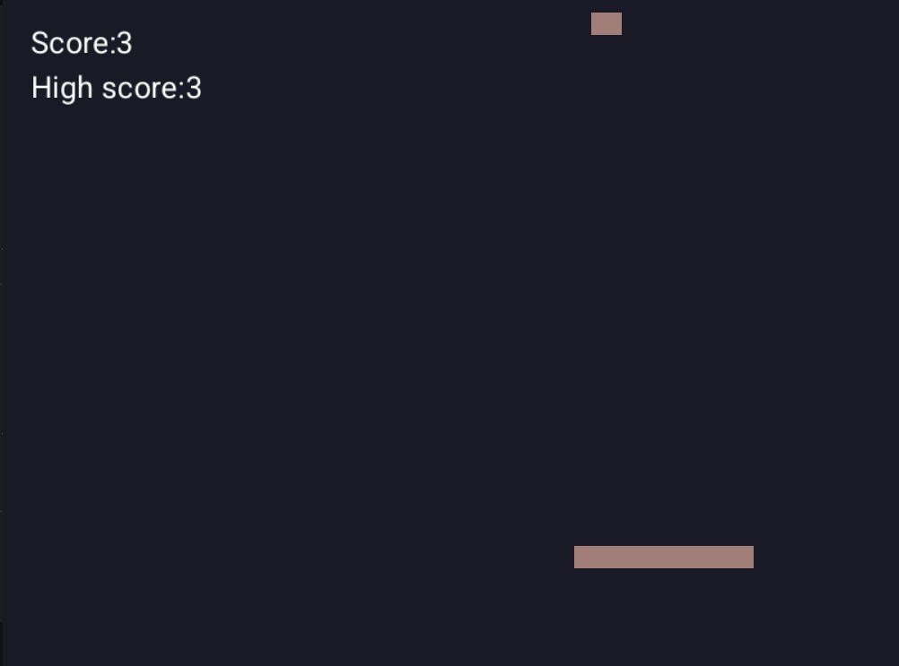
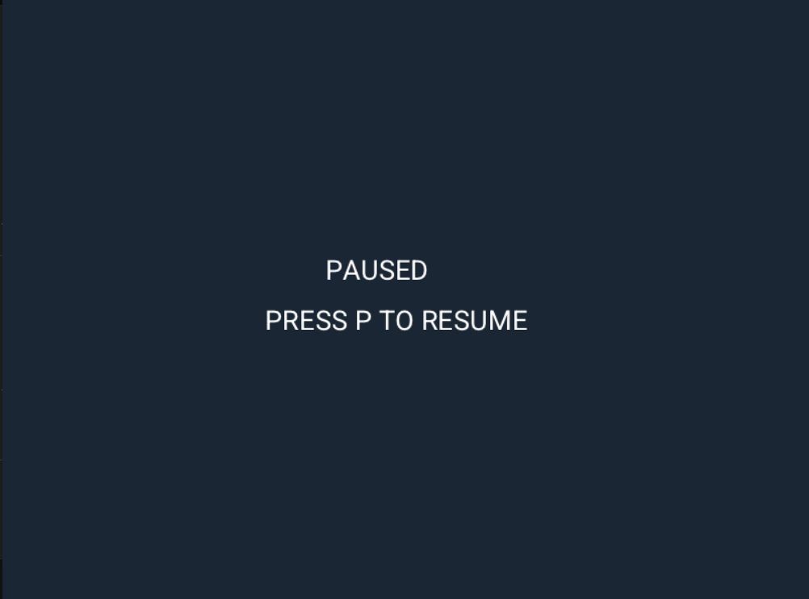
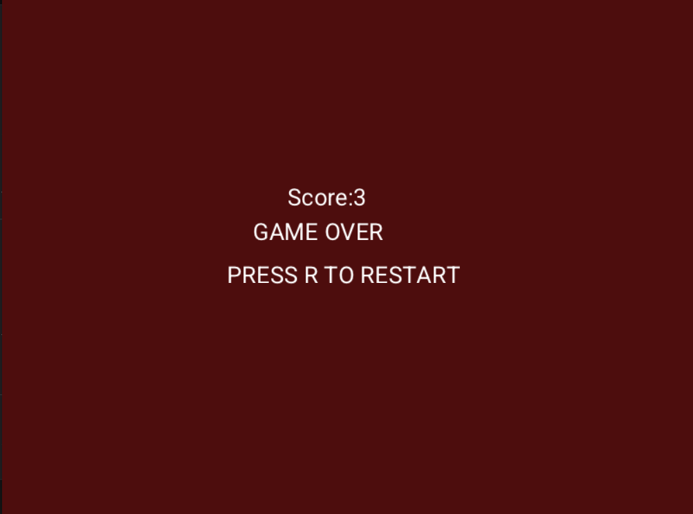

# OpenGL-Pong
Is a game, where you can play a pong against yourself infinitely. You move the paddle left [LEFT_BUTTON] and right [RIGHT_BUTTON]. You can see the score and highscore on the left top of the screen and each time you get one score the color of the ball and paddle randomly changes.




## Pausing the game
You can pause the game using [P] and unpause it with [P].



## Game Over
When you lose the game it says game over and you can restart it with [R]



## How to run it?

You can either run it compiled from my github release or compile it youself.

### For linux:
You need to have all these things installed:
```
sudo apt update
sudo apt install build-essential cmake


sudo apt install libgl1-mesa-dev libglu1-mesa-dev

sudo apt install libglfw3-dev
```

Then you need to clone my repo and in the root create a folder named build
``` 
mkdir build
cd build
```
Then run this commant to compile the code:
```
cmake ..
make
```
If it works you can run it with this:
```
./OpenGLPong
```
Or if it doesnt work try this:
```
GDK_BACKEND=x11 ./OpenGLPong
```

### For windows

You can compile it yourself or in releases there is compiled .exe

[Windows exe](https://github.com/tomstraka01-git/OpenGL-Pong/releases)

## Does it end?
No it doesnt it is going to run forever until you either close the game or you die, it gets harder each score.

